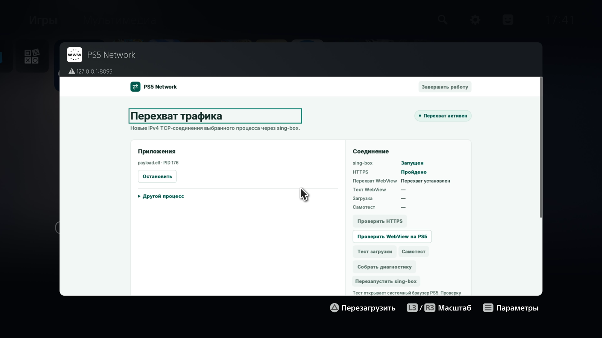
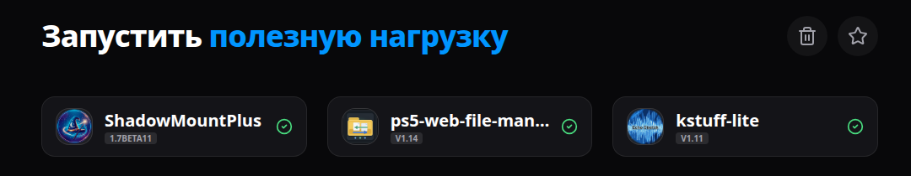
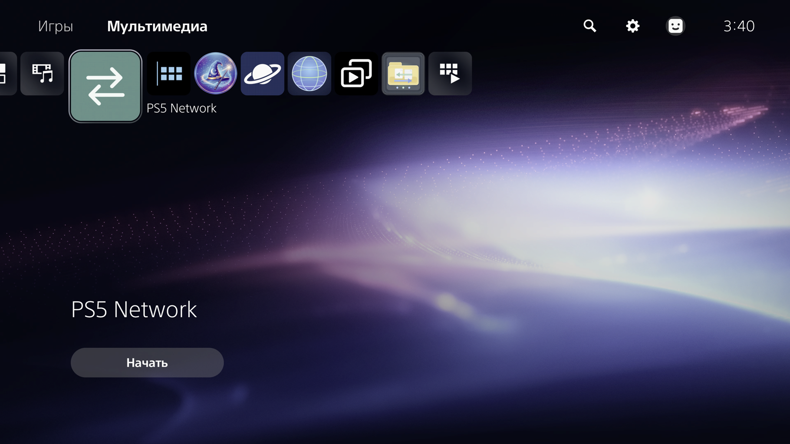
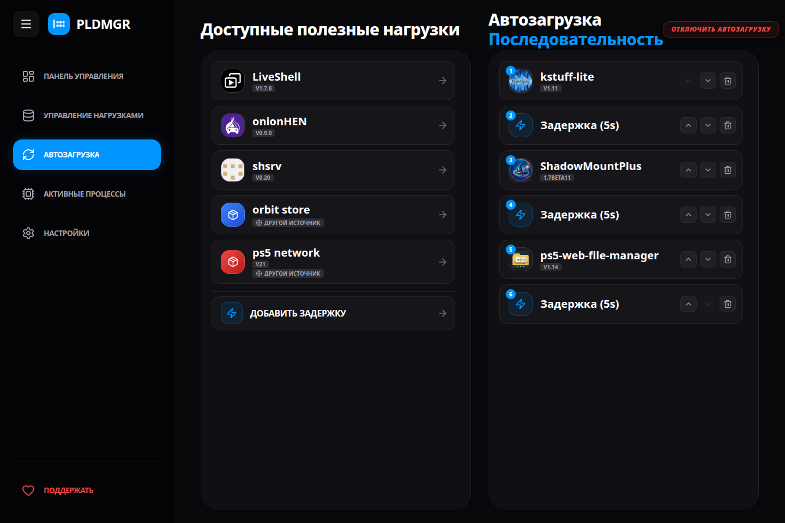

<p align="center">
  
</p>

<h1 align="center">ps5-signbox-tools</h1>

<p align="center"><strong>PS5 Network 0.22</strong><br>sing-box на консоли, свой сетевой маршрут и управление из «Мультимедиа».</p>

<p align="center"><strong>PS5 12.20</strong> · <strong>sing-box 1.14.4</strong> · <a href="LICENSE">Собственный код под MIT</a></p>

<p align="center"><a href="elf/ps5-network-v22.elf"><strong>Скачать готовый ELF</strong></a> · <a href="elf/SHA256SUMS.txt">SHA-256</a> · <a href="https://cyberkingdom.agency/blog/ps5-orbit-singbox/">Полная инструкция со скриншотами</a></p>

PS5 Network запускает sing-box прямо на PlayStation 5, направляет выбранные внешние TCP-соединения Orbit и WebView через свой профиль и проверяет доступ к сети с самой консоли. Панель можно открыть плиткой **PS5 Network** в разделе **Мультимедиа** или из браузера компьютера в домашней сети.



**Панель 0.22 на самой PS5 без формы входа.** На кадре работают sing-box и перехват Orbit и WebView. Здесь включается маршрут и читается журнал.

[Установка](#install) · [Плитка на PS5](#media) · [Свой конфиг](#можно-ли-использовать-свой-конфиг-sing-box) · [Проверки](#checks) · [Диагностика](#diagnostics) · [Исходники и сборка](#source)

Для кадров из интерфейса консоли есть отдельный [комплект съёмки](capture-tools/README.md) с готовым ELF, Python-клиентом и исходниками PS5 DevLoop. Его настройка описана также в [бонусе к статье](https://cyberkingdom.agency/blog/ps5-orbit-singbox/#bonus).

## Что изменилось в 0.22

- **Открытие с PS5 без ввода кода.** Плитка в «Мультимедиа» открывает `http://127.0.0.1:8095/`; панель автоматически выдаёт сеанс локальному браузеру. При входе с компьютера по LAN по-прежнему нужен код из уведомления.
- **Исправлен выбор сборки Orbit.** Кэш `/data/orbit-store/orbit_store.elf` и встроенный ELF TV-приложения могут отличаться даже при одинаковом номере версии. Панель проверяет оба источника по фрагментам кода запущенного процесса и подключает подходящий. Файлы самого Orbit не изменяются.
- **Видно частичный запуск.** Если удалось подключить только браузерный процесс, статус показывает «Работает только WebView» и причину отказа Orbit.

[Подробности реализации и проверок](docs/CHANGELOG.md). Существующие `config.json` и плитка подходят для обновления.

## Для чего это нужно

При прямом подключении из России часть внешних ресурсов, которые нужны Orbit, недоступна. PS5 Network позволяет выбрать доступный маршрут через свой прокси или VPN и проверить его в том же окружении, где работает приложение.

- **Одна панель для повседневной работы.** Перезапуск sing-box, состояние соединения, проверки HTTPS и загрузки, журнал и отчёт диагностики.
- **Управление с геймпада.** Установщик добавляет плитку в «Мультимедиа», которая открывает локальную панель на PS5.
- **Свой сервер и свой JSON.** В репозитории есть четыре примера, а загрузчик принимает совместимые пользовательские конфиги sing-box.
- **Проверки с консоли.** Запросы HTTPS, передача тестовых данных и соединение с прокси или VPN выполняются на PS5. Компьютер нужен для первоначальной передачи файлов и удобного редактирования профиля.

В репозитории опубликованы все исходные модули 0.22, веб-интерфейс, встроенное ядро, зависимости, файлы сборки и установщик плитки. Рабочая установка использовала **PS5 12.20**, сервис **Orbit 1.9.0** и его **TV-приложение 1.13.0**. Готовый ELF проверяет именно прошивку **12.20**. Поддержку других прошивок эта сборка не заявляет.

<a id="install"></a>

## Установка и первый запуск

Для начала нужны PS5 на **12.20** с уже настроенной средой запуска ELF и компьютер в той же домашней сети. Понадобятся Payload Manager и файловый менеджер. Для внешнего маршрута подготовьте данные своего прокси или VPN. Начальная установка WebKit Autoloader и остальных компонентов подробно разобрана в [статье](https://cyberkingdom.agency/blog/ps5-orbit-singbox/#step-03).

1. Скачайте [ps5-network-v22.elf](elf/ps5-network-v22.elf) и [SHA256SUMS.txt](elf/SHA256SUMS.txt). Сверьте SHA-256. В `elf/` лежат новая 0.22 и исходная 0.21 для отката.
2. Через Payload Manager импортируйте ELF во внутреннюю память PS5. При замене работающего экземпляра сначала нажмите **Остановить**, затем **Завершить работу** в прежней панели.
3. Подготовьте профиль по разделу **Как поставить профиль** и загрузите его как **`/data/ps5-local-proxy/config.json`**. При замене существующего файла сохраните его копию. Если каталог ещё не создан, первый запуск ELF создаст его. После загрузки файла перезапустите sing-box из панели.
4. Запустите основной **`ps5-network-v22.elf`**. Откройте **`http://IP-PS5:8095/`** и введите восьмизначный код из уведомления консоли. Например, при адресе PS5 `192.168.1.80` панель находится на `http://192.168.1.80:8095/`.
5. Дождитесь строки **`HTTP/SOCKS5 proxy ready at 127.0.0.1:17890`** и статуса **Запущен**. Если запустили ELF до загрузки профиля, ошибка открытия `config.json` ожидаема. Положите файл по указанному пути и нажмите **Перезапустить sing-box**.
6. Выполните проверки соединения и только затем включайте маршрут для Orbit. Для управления с самой PS5 установите плитку по инструкции ниже.



**Импорт и запуск с компьютера.** На кадре реальная веб-панель Payload Manager. Передача файлов идёт по домашней сети.

<a id="media"></a>

## Как открыть панель с самой PS5

1. Распакуйте [установщик плитки](panel-launcher/ps5-network-media.zip) и сверьте SHA-256. Импортируйте `ps5-network-media.elf` в Payload Manager и выполните один раз. После уведомления об установке откройте раздел **Мультимедиа** на PS5 и выберите **PS5 Network**.
2. Ярлык ведёт на `http://127.0.0.1:8095/`. Перед открытием запустите установленную PS5 Network 0.22. На самой консоли панель откроется автоматически, без PIN, логина и пароля. Вход по восьмизначному коду нужен только при подключении с компьютера по LAN.
3. После полного выключения снова запустите сервис PS5 Network в вашей настроенной среде. Плитка сохраняется на диске.

При отсутствии функции регистрации отдельного приложения установщик использует штатное общее пересканирование каталога. Оно может добавить ярлыки других готовых приложений из `/user/app/`. [Исходник, сборка и проверка установщика](panel-launcher/media/README.md)

### Открытие через Payload Manager

Распакуйте готовый ELF и один раз импортируйте его через установленный Payload Manager. Дальше на консоли откройте ярлык **Payload Manager**, выберите `ps5-network-open-panel.elf`. Панель 0.22 войдёт автоматически, без ввода кода. Он проверяет, что панель уже запущена, и открывает **`http://127.0.0.1:8095/`** в системном браузере. [Готовый ELF с контрольной суммой](panel-launcher/ps5-network-open-panel.zip) · [Исходник и сборка ELF](panel-launcher/README.md)



**Плитка на консоли.** Её установщик выполняется один раз. Основной ELF запускает сервис панели в каждом рабочем сеансе. Адрес открытия на самой PS5 — `http://127.0.0.1:8095/`.

## Как поставить профиль

1. На PS5 с уже запущенной 0.22 откройте `/data/ps5-local-proxy/` в своём файловом менеджере. Сохраните копию действующего `config.json` в отдельном месте.
2. Возьмите свой конфиг sing-box или подходящий JSON из таблицы ниже. Укажите параметры сервера и ключи. Для первого прямого замера используйте профиль **direct**.
3. Проверьте, что в файле ровно один вход `mixed` на `127.0.0.1:17890`. У этого входа нет пользователей и TLS. `set_system_proxy` оставьте выключенным. Для профиля с внешним выходом сохраните прямое правило к `127.0.0.0/8`.
4. Загрузите файл на консоль как `/data/ps5-local-proxy/config.json`. Откройте панель по LAN-адресу PS5 на порту `8095` и введите код, показанный консолью.
5. Нажмите **Перезапустить sing-box**. Дождитесь статуса **Запущен** и строки `HTTP/SOCKS5 proxy ready at 127.0.0.1:17890`.
6. Нажмите **Проверить HTTPS** и сверьте внешний IPv4. Затем выполните **Тест загрузки**. После этих проверок откройте нужную страницу из Orbit и проверьте, начала ли расти задача в очереди.

Если профиль не загрузился, сохраните текст ошибки панели. Верните рабочую копию на прежнее место и снова перезапустите sing-box. [Описание mixed в sing-box](https://sing-box.sagernet.org/configuration/inbound/mixed/)

## Какой JSON выбрать

| Профиль | Маршрут | Что нужно указать |
| --- | --- | --- |
| [direct](examples/config.direct.json) | Выход напрямую через сеть PS5 | Рабочая сеть и доступный DNS |
| [SOCKS5](examples/config.socks5.json) | Через внешний SOCKS5 | Адрес и порт. При необходимости `username` и `password` в выходе `upstream` |
| [WireGuard через Hysteria2](examples/config.wireguard-hysteria2.json) | Трафик и DNS через WireGuard, транспорт WireGuard через Hysteria2 | Сервер Hysteria2, WireGuard peer, ключи, адреса и DNS внутри туннеля. Этот маршрут проверен на PS5 |
| [WireGuard через Naive](examples/config.wireguard-naive.json) | WireGuard с транспортом Naive HTTP/2 | Сервер Naive с UDP over TCP и данные WireGuard. Такой вариант входит в исходную 0.22 |

В варианте с Hysteria2 заполните выход `udp-quic`: адрес, UDP-порт, пароль и имя сертификата. В endpoint `wg-private` оставьте `system: false`, укажите внутренний адрес клиента и ключ WireGuard. Для peer нужны публичный ключ, адрес и порт. Поле `pre_shared_key` заполните при использовании общего ключа с обеих сторон. Адрес `127.0.0.1:51820` в примере относится к серверу, на котором завершается Hysteria2. Если WireGuard находится на другой машине, укажите адрес, доступный оттуда. В `vpn-dns` нужен DNS, доступный из WireGuard. [WireGuard endpoint](https://sing-box.sagernet.org/configuration/endpoint/wireguard/) · [Hysteria2 outbound](https://sing-box.sagernet.org/configuration/outbound/hysteria2/)

В шаблонах стоят демонстрационные адреса и заглушки. Рабочие ключи, пароли и временные ссылки храните в своём профиле на консоли.

### Можно ли использовать свой конфиг sing-box

**Да.** Четыре файла в `examples/` показывают готовые схемы подключения. Загрузчик читает пользовательский JSON sing-box, включая его выходы, DNS и правила маршрутизации. WireGuard поверх Hysteria2 нужен только для соответствующего примера. Можно выбрать другой поддерживаемый выход и пользоваться своим сервером.

В PS5 Network 0.22 встроен **sing-box 1.14.4** с набором компонентов, перечисленным в [core/main.go](core/main.go). Перед переносом своего профиля проверьте совместимость с этой версией и таблицей.

| Компонент | Что зарегистрировано в сборке |
| --- | --- |
| Локальный вход | Один `mixed` для HTTP CONNECT и SOCKS5 на `127.0.0.1:17890` |
| Выходы | `direct`, `http`, `socks`, `shadowsocks`, `trojan`, `vless`, `vmess`, `hysteria2` |
| Naive | Собственная реализация `naive` через HTTP/2 CONNECT с проверкой TLS. Для переноса UDP нужен совместимый сервер UDP over TCP |
| WireGuard | `wireguard` в `endpoints`, в пользовательском пространстве с `system: false` |
| DNS | `local`, `hosts`, `udp`, `tcp`, `tls`, `https` |

Это перечень подключённых компонентов. Сложный профиль другого клиента может дополнительно требовать адаптации. В 0.22 не зарегистрированы вход TUN, выходы `selector`, `urltest` и TUIC. Вариант Naive через QUIC также не реализован.

Чтобы перенести свой профиль, выполните следующие действия.

1. Сохраните резервную копию действующего `/data/ps5-local-proxy/config.json`. Возьмите готовый JSON sing-box. Ссылку подписки, URI `vless://` и YAML другого клиента сначала нужно преобразовать в конфигурацию sing-box на компьютере.
2. Замените блок `inbounds` фрагментом ниже. Это часть конфигурации. Остальные разделы вашего JSON остаются в том же корневом объекте.

```json
"inbounds": [
  {
    "type": "mixed",
    "tag": "local",
    "listen": "127.0.0.1",
    "listen_port": 17890
  }
]
```

3. Уберите из этого входа пользователей, TLS и включение системного прокси. Если правила ссылаются на старый тег входа, замените его на `local` или сохраните свой тег в приведённом блоке. Само имя тега сборка не фиксирует.
4. Проверьте типы выходов и DNS по таблице. Если профиль выбирал сервер через `selector` или `urltest`, укажите нужный поддерживаемый выход непосредственно в `route.final` и обновите ссылки на прежний селектор в правилах, DNS и цепочках `detour`. Исправьте пути к файлам правил и сертификатам, которые существовали только на исходном устройстве. Для контрольных обращений панели к локальному адресу сохраните прямой маршрут к `127.0.0.0/8`.
5. При использовании WireGuard перенесите его в формат `endpoints` этой версии, оставьте `system: false` и проверьте ключи. Приватный, публичный и необязательный общий ключ должны декодироваться из Base64 в 32 байта. Профилю без WireGuard эти поля не нужны.
6. Загрузите результат обычным файлом `config.json` по указанному пути. Допустимый размер — до **1 МиБ**, символические ссылки не принимаются. В панели нажмите **Перезапустить sing-box**, дождитесь строки готовности, затем проверьте HTTPS, внешний IP и реальный источник в Orbit.

Если sing-box отверг профиль, первая ошибка в журнале укажет на разбор JSON или запуск компонента. Верните сохранённую копию и повторите перезапуск. Панель перечитывает конфиг при каждом запуске ядра. Пересобирать ELF для смены поддерживаемого профиля не требуется.

Ретранслятор передаёт в SOCKS5 исходный IPv4-адрес назначения. Если ваш профиль выбирает маршрут по доменному имени, отдельно проверьте, как ядро получает это имя, например через sniffing. DNS в конфиге sing-box настраивает резолвер ядра. Системный DNS PS5 задаётся в настройках консоли.

<a id="checks"></a>

## Подключаем Orbit и проверяем результат

1. При готовом sing-box нажмите **Проверить HTTPS**, сверьте внешний IPv4 и выполните **Тест загрузки**. Эти проверки доступны до включения перенаправления приложений.
2. Откройте нативный Orbit и дождитесь каталога. В панели нажмите **Orbit и WebView через VPN**. Приложение определит процесс сервиса Orbit, подключит его сетевой маршрут и начнёт ждать сетевой процесс WebView.
3. В Orbit откройте нужный внешний ресурс. Ориентируйтесь на статусы **Перехват активен**, **Ожидает сетевой процесс** и **Перехват установлен**. Для дополнительной проверки браузера есть **Проверить WebView на PS5**.
4. Дождитесь появления задачи и роста принятых байтов в Orbit. Сам факт готовности локального входа ещё не подтверждает доступность внешнего сервера или успешную проверку ссылки.
5. После работы нажмите **Остановить**. Перед заменой основного ELF дождитесь остановки и нажмите **Завершить работу**. Для смены JSON достаточно **Перезапустить sing-box** при остановленном перенаправлении.

### Что находится в панели

| Действие | Результат |
| --- | --- |
| **Orbit и WebView через VPN** | Подключает маршрут сервиса Orbit и наблюдение за сетевым процессом браузера |
| **Проверить HTTPS** | Проверяет внешний ответ через HTTP CONNECT и SOCKS5 с PS5 |
| **Тест загрузки** | Измеряет передачу контрольного объёма с консоли |
| **Перезапустить sing-box** | Заново читает профиль с диска и запускает ядро |
| **Самотест** | Проверяет три локальных TCP-обмена с перенаправлением |
| **Собрать диагностику** | Выполняет проверки WebView и ELF-загрузчика, готовит отчёт |
| **Скачать лог / Скачать диагностику** | Сохраняет данные для разбора ошибок |

## Что измеряет панель

- **Проверить HTTPS** обращается с PS5 к `api.ipify.org` по цепочке HTTP CONNECT и SOCKS5 и выводит IPv4 каждого выхода. Локальная готовность и возможность получить внешний ответ имеют свои статусы.
- **Тест загрузки** по умолчанию читает 4 МиБ с `speed.cloudflare.com`. В журнал попадают принятый объём, время и скорость в МиБ/с.
- Для выборочной проверки своего файла запишите одну действующую HTTPS-ссылку в `/data/ps5-local-proxy/download-url.txt`. Тот же тест запросит начало файла до 1 МиБ и покажет статус, тип ответа и время до заголовков. Уберите временный файл после проверки, чтобы снова использовать контрольный адрес.

Короткий тест до CDN и вся загрузка с другого сервера дают разные числа. Для сравнения двух профилей используйте один источник, одинаковое число соединений и одинаковый интервал. Покажите в отчёте и байты, и время.

## Проверка уже настроенной PS5 после включения

Подробная подготовка консоли, установка Orbit, автозагрузка и проверка соединения разобраны в статье. [Руководство для PS5](https://cyberkingdom.agency/blog/ps5-orbit-singbox/)

В схеме с **WebKit Autoloader** переход к Payload Manager происходит до запуска Orbit и PS5 Network. Установленные приложения и профили лежат на диске. После полного выключения проверьте готовность сервисов в новом сеансе.

1. Загрузите свою настроенную среду обычным способом. Откройте Payload Manager на PS5 и дождитесь, пока загружается список приложений. Если пользуетесь веб-панелью на ПК, берите LAN-адрес и порт из текущего сеанса.
2. Проверьте ShadowMountPlus и доступность диска с образом Orbit. При работе с файлами откройте Web File Manager и сверьте `/data/homebrew/`.
3. Запустите установленную PS5 Network 0.22 и откройте её панель на порту `8095`. Строка `HTTP/SOCKS5 proxy ready at 127.0.0.1:17890` покажет, что sing-box готов принять соединения.
4. Откройте Orbit и проверьте очередь. После неожиданной остановки сверяйте диск и путь частичного файла перед возобновлением.

Если Payload Manager уже открывается на консоли, а браузер ПК не видит его, начните с текущего IP, порта и подключения к одной домашней сети. К настройке профиля переходите, когда открывается панель PS5 Network.



**Моя очередь после ручной проверки.** На кадре kstuff-lite, паузы по 5 секунд, ShadowMountPlus и файловый менеджер. Для первой настройки в статье предложен запас 10 секунд. Готовность PS5 Network и профиля проверяется отдельно после запуска среды.

## Как устроен маршрут


В моём рабочем профиле конечный выход — WireGuard с транспортом через Hysteria2. Для другого поддерживаемого профиля цепочку задаёт пользовательский JSON. Ретранслятор передаёт байты TLS между приложением и удалённой стороной. Проверку HTTPS и результата ссылки продолжает выполнять само приложение.

### Как выбирается процесс Orbit

Панель находит сервис по локальному порту `34177` и проверяет его PID и время запуска. Затем сравнивает три фрагмента исполняемого кода с ELF из `/data/orbit-store/orbit_store.elf`. Если кэш не подошёл, проверяет `app0/orbit/orbit_store.elf` в каталогах `/mnt/sandbox/PPSA99177_<номер>/` установленного приложения. Номер версии не заменяет эту проверку: разные сборки могут называться одинаково. Перехват устанавливается только после совпадения кода и проверки адреса импорта `connect`.

В диагностике видны строки `Orbit reference path=... bytes=... result=... errno=...` для каждого проверенного файла. Строки `Orbit live image matched ...` и `Orbit VPN active ...` подтверждают подключение. Если совпадения нет, скачайте диагностику. Статус «Работает только WebView» означает, что сетевой процесс браузера подключился, а сам Orbit — пока нет. После перезапуска сервиса Orbit нажмите **Остановить**, затем **Orbit и WebView через VPN**, чтобы панель выбрала его новый процесс.

### Адреса и файлы

| Компонент | Адрес или файл | Роль |
| --- | --- | --- |
| Панель PS5 Network | `http://IP-PS5:8095/` из домашней сети | Перезапуск sing-box, тесты и журнал. Для входа нужен код из уведомления PS5 |
| Сетевой процесс | `127.0.0.1:17890` на PS5 | Общий вход HTTP CONNECT и SOCKS5. Выбирает выход на основе профиля |
| Профиль | `/data/ps5-local-proxy/config.json` на PS5 | Вход, выходы, маршруты и DNS sing-box |
| Ретранслятор | Локальный TCP на PS5 | Открывает через SOCKS5 соединение к исходному адресу и передаёт байты в обе стороны |
| Плитка в «Мультимедиа» | `ps5-network-media.elf` | Устанавливает ярлык PS5 Network для локальной панели |
| Открытие через менеджер | `ps5-network-open-panel.elf` | Открывает работающую панель в браузере самой консоли |

Перенаправление в 0.22 рассчитано на выбранные внешние **IPv4 TCP-соединения**. QUIC и другой UDP приложений требуют отдельных механизмов и проверок. Наличие Hysteria2 или WireGuard внутри профиля описывает транспорт ядра и не означает, что весь системный трафик PS5 автоматически попал в этот маршрут.

<a id="diagnostics"></a>

## Где искать ошибку

| Симптом | Проверка |
| --- | --- |
| Панель недоступна по LAN | Проверьте адрес PS5, подключение к одной сети и готовность основного ELF |
| Процесс панели есть, порт 8095 не отвечает | Сохраните журналы через файловый менеджер. Для восстановления начните новый чистый сеанс после полного перезапуска PS5 |
| sing-box не запустился | Сверьте вход, формат JSON, поддержку типа выхода и размер ключей WireGuard |
| Прокси готов, HTTPS падает | Проверьте внешний выход и доступность DNS, сверив ошибки HTTP и SOCKS5 |
| HTTPS работает, страница провайдера висит | Откройте её из Orbit и сопоставьте браузерное событие со строкой ретранслятора |
| После ручной проверки нет задачи | Проверьте отчёт Orbit о кандидате ссылки, сессию и соответствие версии клиента сервису |
| Каталог работает, файл идёт медленно | Смотрите байты, время и число соединений в одном интервале, затем `socks_ms`, `first_rx_ms` и `app_wait_ms` |

Общий журнал находится в `/data/ps5-local-proxy/tcp-relay.log`, сводный отчёт — в соседнем `diagnostics.txt`. `app_wait_ms` показывает время, пока уже принятые данные ждали отправки приложению. Нулевое значение в медленной передаче смещает проверку к поступлению данных от внешней стороны. Точное место замедления выясняется дополнительными замерами. Для проблем после капчи нужен также отчёт Orbit за то же время. Перед передачей журналов удалите коды доступа и временные ссылки. [Проверка источников в Orbit](https://github.com/saawant12/orbit-store-ps5/blob/main/guides/downloads.md)

<a id="source"></a>

## Устройство исходников

| Файлы | Что в них |
| --- | --- |
| [core/main.go](core/main.go) | Чтение и проверка профиля, набор протоколов и запуск sing-box 1.14.4 |
| [core/egress.go](core/egress.go), [core/download.go](core/download.go) | HTTPS-проверки и измерение загрузки с ограничением времени и объёма |
| [core/naive_h2.go](core/naive_h2.go), [core/naive_stream.go](core/naive_stream.go) | Клиент Naive поверх HTTP/2 CONNECT и транспорт датаграмм для WireGuard |
| [relay.c](relay.c), [relay.h](relay.h) | SOCKS5 CONNECT, неблокирующая передача и счётчики. На каждое направление выделяется 64 КиБ |
| [examples/](examples) | Четыре профиля 0.22 с демонстрационными настройками |
| [panel-launcher/](panel-launcher) | Установка плитки в «Мультимедиа» и открытие работающей панели из Payload Manager |

Собственные исходники проекта распространяются под [MIT](LICENSE). sing-box 1.14.4 и отдельные включённые компоненты сохраняют свои условия. Для собранного ELF нужно учитывать лицензии всех встроенных частей. [Лицензии зависимостей](THIRD_PARTY_NOTICES.md)

<details>
<summary><strong>Сборка из исходников и состав полной 0.22</strong></summary>

## Сборка полной PS5 Network 0.22

Основа — предоставленный архив 0.21 с полными исходниками. В 0.22 добавлены автоматический вход с самой консоли, выбор подходящего ELF Orbit из кэша или установленного TV-приложения и явное отображение режима, в котором подключился только WebView. Механизмы перенаправления остаются на PS5; встроенное ядро sing-box сохранено.

На Linux x86-64 понадобятся Bash, Python 3, unzip, curl, make и LLVM. Из корня выполните команду.

```bash
./build.sh
```

При первом запуске скрипт распакует фиксированный vendor-снимок в core/vendor, подготовит PS5 Payload SDK v0.45 и исходную цепочку Go 1.27.1. Контрольные суммы и версии заданы в build.sh. В README исходной сборки описаны ограничения прошивки и способ запуска.

Готовый ELF рассчитан на PS5 12.20. [Инструкция 0.22](docs/PS5-Network-0.22.md) · [Изменения и проверки](docs/CHANGELOG.md)

### Повторная сборка C и интерфейса с готовым ядром

Если ядро Go не менялось, можно явно передать уже собранный **PS5** PIE-образ этого ядра в `PS5_CORE_IMAGE=/путь/proxy-go.bin ./build.sh`. Это пропускает пересборку Go, но заново собирает оболочку, worker, обработчики и интерфейс. Образ должен соответствовать исходникам `core/` и патчу из `upstream/`; обычный бинарник sing-box для Linux или FreeBSD не подходит. Без этой переменной выполняется полная сборка из исходников.

Проверки логики доступа, выбора ELF и интерфейса выполняются на компьютере:

```bash
python3 -m unittest discover -s tests -v
node --test tests/panel.test.cjs
```

Для первого набора нужен C-компилятор `cc`, для второго — Node.js 18+. Эти проверки дополняют запуск на PS5: совместимость отладочных вызовов и реальную передачу трафика проверяют на консоли.

## Модули полной сборки

- main.c, panel.c и panel-access.c запускают веб-панель, проверяют локальные подключения и управляют жизненным циклом приложения.
- trace.c, process.c и webview-imports.c содержат исходные механизмы отладочного доступа и поиска процессов.
- orbit-image.c, orbit-source.c, orbit-connect.c и orbit-run.c содержат интеграцию с Orbit и проверку соответствия его запущенной сборки.
- webview.c и webview-hook.h содержат исходную интеграцию с браузерным процессом.
- goload.c и service.c запускают встроенное ядро.
- worker.c, relay.c, diagnostics.c и report.c обслуживают передачу, отмену и отчёты.
- ui/ содержит HTML, CSS, JavaScript и шрифты панели.
- upstream/ содержит исходные архивы и фиксированные зависимости, которые использует сборка.

</details>
